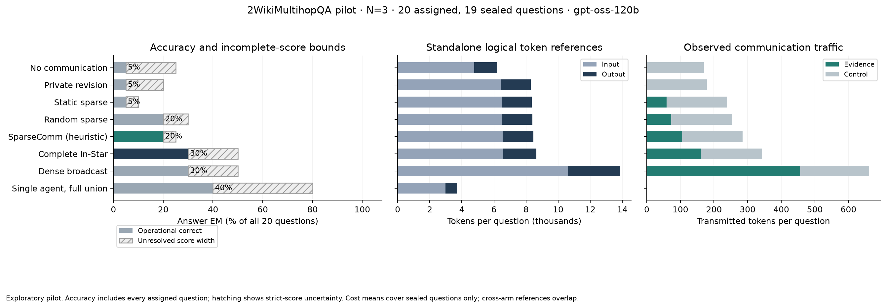

# 2Wiki pilot decision: do not expand the current protocol

The user's instruction was to inspect trends and run the full study if they were good. The observed results do not justify that expansion. No full benchmark, FinQA run, or additional paid repair run was started.

This was an exploratory, 20-question training-split pilot with N=3 partitioned agents on the existing Azure gpt-oss-120b deployment. Nineteen question records completed. An initial-agent call on the twentieth question timed out; its generation and billing status remain unknown. That call was not retried and the original namespace remains blocked. All assigned questions remain in the analysis.

## What the pilot measured

- Selected SparseComm heuristic: **4 correct out of 20 assigned**.
- Random routing: **4 correct**; no observed primary routing advantage. The paired operational difference was 0 percentage points, with bootstrap 95% interval [-15, +15] and exact McNemar p=1.
- Dense broadcast and complete In-Star: **6 correct each**.
- Full-union single agent: **8 correct**.
- No communication, private revision, and static sparse: **1 correct each**.

These counts treat invalid outputs and the unfinished question as operational failures. They are not complete official answer-accuracy estimates. Strict scores remain incomplete: selected-minus-random identification bounds are [-10, +5] percentage points. These bounds describe missing-score uncertainty, not confidence intervals. This small exploratory sample cannot establish population superiority, equivalence, or a scaling law.

Known standalone logical model-token references for the 19 completed question records were 160,852 for selected routing, 263,351 for dense, and 70,439 for full union. Selected routing saved **38.9%** against dense but had fewer observed correct answers. Full union used **56.2% fewer tokens than selected routing** and answered twice as many questions correctly. Cross-arm references overlap because common initial calls are physically reused; summing them is not a bill. Currency cost and timeout usage remain unknown.

In-Star used 164,051 logical model tokens, 37.7% below dense. Its sink request is byte-identical to dense in frozen one-round W1 and physically reused, so identical sink results are structural, not independent evidence of quality equivalence or a learned-router advantage.

Abstention-aware voting improved observed operational success over original voting, but did not establish a routing advantage: selected and random both reached 25%; dense reached 40%. Readout rules were common across arms, not chosen separately to favor a method.

## Diagnosed failures

Two saved examples illustrate missing complementary evidence under the one-sender heuristic:

1. For the later birth of Augustus Herman Pettibone versus Vladimir Kasatonov, the selected sender supplied Kasatonov evidence but the sink still needed Pettibone's birth date. Complete In-Star answered correctly.
2. For the birthday of the director of *Billy the Kid in Santa Fe*, selected routing supplied cinematographer Jack Greenhalgh rather than director Sam Newfield's birthday. Complete In-Star answered correctly.

These are diagnostic cases, not a semantic audit of every prediction. Across 185 confirmed provider responses, 162 parsed validly, 21 violated the output contract, and two were refusals. The invalid cases included eight invisible-source citations, eight list-limit failures, three unknown derivation facts, and two inconsistent unresolved answers. None ended by output-token truncation. The selected sink was valid on every completed question, so schema failures alone do not explain its missing answers.

## Next change worth testing

A further small matched pilot should test routing that targets the sink's unresolved entity/relation needs, selects a complementary second sender when necessary, and stops when the required evidence is covered. All controls should receive the same clearer schema instructions. Keep the full-union baseline, random routing, common readout, and both model-token and communication-token accounting.

This is a recommendation, not an implemented or measured improvement. The current selected router is an untrained deterministic metadata heuristic; no learned SparseComm checkpoint was evaluated. Common improved prompts do not isolate a prompt-change effect. No held-out benchmark claim follows from this pilot.

## Preserved evidence and verification

- [Machine-readable summary](results/summary.json), [all 20 assigned predictions](results/predictions.json), and [recovery audit](results/recovery_audit.json).
- [Detailed original analysis report](../../web_reasoning/artifacts/2wiki_pilot_20261016/analysis_partial/REPORT.md), including paired contrasts and every readout.
- [Strict incomplete-score report](../../web_reasoning/artifacts/2wiki_pilot_20261016/representative_run/reports/partial_pilot/report.json).
- [Source and sampling provenance](../../web_reasoning/artifacts/2wiki_pilot_20261016/source/representative_provenance.json) and [frozen manifest](../../web_reasoning/artifacts/2wiki_pilot_20261016/representative_run/manifest.json).
- [Authorized protocol and pre-inference sampling amendments](STUDY_PLAN.md).

Raw requests, provider responses, the append-only call ledger, source archive, frozen inputs, and both candidate samples remain in the local ignored artifact directory. The compact results here are byte-for-byte copies of the audited analysis outputs; large source downloads and credential-bearing files are not included. Source/input/code hashes and sealed result/response hashes were verified offline. The unresolved attempt remains explicitly recorded; no synthetic terminal event or fabricated usage was added.
