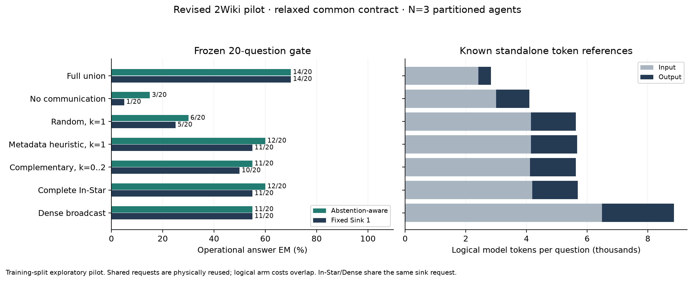

# Revised 2Wiki: measured pilot decision

**Gate FAILED**. 20 complete question records; all assigned pilot questions retained.

**Outcome:** all 171 physical responses passed the relaxed contract (0% failures). NoComm met the <=15% ceiling under both readouts. In-Star and complementary exceeded NoComm and random routing, but did not beat the metadata one-sender control. Complementary also fell below Dense on Sink 1. The remaining 80 questions were not run.

Reasons: no_strict_improvement:instar:heuristic:abstention_aware:em; no_strict_improvement:instar:heuristic:abstention_aware:f1; no_strict_improvement:complementary:heuristic:abstention_aware:em; no_strict_improvement:complementary:heuristic:abstention_aware:f1; no_strict_improvement:instar:heuristic:sink1:em; no_strict_improvement:instar:heuristic:sink1:f1; no_strict_improvement:complementary:heuristic:sink1:em; no_strict_improvement:complementary:heuristic:sink1:f1; below_dense_sink:complementary:em; below_dense_sink:complementary:f1.

| Arm | Abstention-aware correct / 20 | AA F1 | Sink-1 correct / 20 | Sink-1 F1 | Known model token references |
|---|---:|---:|---:|---:|---:|
| Full union | 14/20 | 76.222 | 14/20 | 76.222 | 56,577 |
| No communication | 3/20 | 15.000 | 1/20 | 5.000 | 81,973 |
| Random, k=1 | 6/20 | 30.000 | 5/20 | 25.000 | 112,499 |
| Metadata heuristic, k=1 | 12/20 | 66.222 | 11/20 | 61.222 | 113,339 |
| Complementary, k=0..2 | 11/20 | 55.000 | 10/20 | 50.000 | 112,542 |
| Complete In-Star | 12/20 | 62.222 | 11/20 | 57.222 | 113,781 |
| Dense broadcast | 11/20 | 64.079 | 11/20 | 57.222 | 177,203 |

The gate uses both readouts and all frozen checks; no threshold or sample was changed after inference. No expansion was run because the gate did not pass.

Unique physical response parse kinds: {"valid": 171}. Contract failure fraction: 0.0. All observed usage fields were present and valid. The original strict-schema ledger is unchanged.

Complementary sender-count distribution: {"0": 1, "1": 17, "2": 2}.

## Interpretation

- Under matched abstention-aware voting, In-Star improves over NoComm by 45 EM percentage points (paired 95% bootstrap interval [25,65], unadjusted exact McNemar p=0.00390625). Complementary improves by 40 pp ([20,60], p=0.0078125). These are exploratory contrasts on previously inspected questions.
- The metadata one-sender control is strong: 12/20 correct under abstention-aware voting and 11/20 at Sink 1. Thus the revised results do not support the broad claim that one sender is inherently insufficient.
- Complete In-Star has the same Sink-1 results as Dense using 113,781 versus 177,203 known logical model-token references, a 35.79% reduction. This fixed-sink equality is a request-identity property.
- The relaxed parser removes source-locator and list-limit rejection by design. This is not a semantic validation of generated facts.
- Full-union single-agent and unchanged-prompt controls remain visible. NoComm was not constrained or filtered to force low accuracy.
- In-Star/Dense Sink-1 equality is structural cache reuse, not an independent equivalence test.
- This evaluates a deterministic complementary router, not learned SparseComm weights. Prompts, parser, packet cap, output cap, and fixed-sink protocol differ from the older pilot; their individual effects are not isolated.
- These are twenty previously inspected publisher training questions with the original assignments, not a new held-out test. Paired intervals in summary.json are exploratory.
- A reported code-review ceiling weakness only arises with missing input usage. Actual usage was complete and independently checked against the pilot limits; future reusable execution should fix that fallback. Frozen executed sources were not changed.

## Saved failure anatomy

- For the two high schools' country comparison, complementary selected sender 0 and abstained; the heuristic selected sender 2 and answered correctly. Broad overlap of entity words is not a reliable certificate that a need is covered.
- For the birthday of the director of Billy the Kid in Santa Fe, complementary selected sender 0 and abstained; Dense combined both packets and recovered the full date. A relation description can require a further bridge even when it matches a source title.
- For the nationality of the Chelsea Girls composer, the two-sender condition (complementary and Dense) abstained while the heuristic's one-sender condition answered American. More incoming packets did not always help in these saved outputs; no semantic judge or further inference was used to attribute the cause.

[Exact diagnostic inputs and results](failure_cases.json)

[All predictions](predictions.json) · [Full metrics and paired intervals](summary.json) · [Independent audit](audit.json) · [Frozen manifest](manifest.json) · [Gate decision](gate_decision.json)

Raw saved requests, provider responses, ledger and complete records remain in `WEBExtension/web_reasoning/artifacts/2wiki_revised_20261016`. Reproduce this audit with `python -m WEBExtension.pilots.2wiki_revised_results_20261016.audit`.
