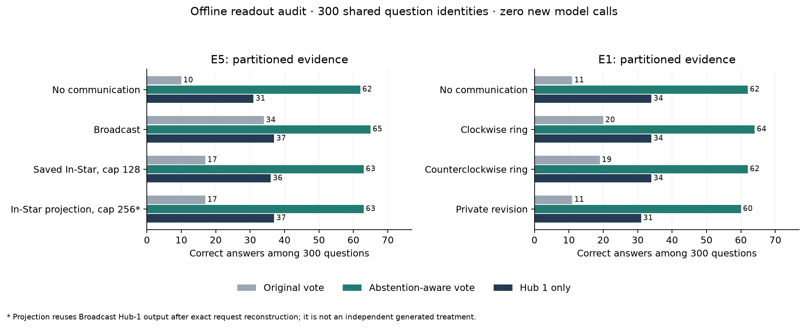

# Offline E5/E1 Sink and Abstention-Aware Readout Audit

**Decision:** keep the one-sender 2Wiki run stopped. Existing E5 supports exact one-round Hub-1 request preservation under a matched-cap In-Star projection, and a strong abstention-aware baseline. It does not establish learned SparseComm superiority or statistical equivalence of the original saved policies. No N=100 2Wiki run was launched.

## What was actually run

Recomputed the existing pure readout functions on all 300 saved questions in E5 and all 300 in E1. These are exactly the same question IDs, not 600 independent questions. Both shared (R) and partitioned (P) regimes, every saved arm, and original voting, abstention-aware voting, and fixed Hub 1 readout were included. Zero Azure calls, credential reads, downloads, training steps, or ledger writes were used. Original artifacts and earlier reports were preserved.

Abstention-aware voting excludes normalized `noanswer` and explicitly marked empty provider refusals, then uses the original vote and agent-order tie rule. All-abstaining pools return `noanswer`. Hub 1 is the fixed zero-based node 1; it is never selected using the gold answer. Gold labels are used only for offline evaluation.



## E5: matched Hub-1 projection versus saved In-Star

The frozen runner updates each recipient synchronously from its own initial state and incoming initial messages. For Hub 1, Broadcast sends exactly the ordered messages from nodes 0 and 2. Deleting the four edges that do not enter Hub 1 leaves its prompt, visible-source set, model parameters, serving identity, and tokenizer identity unchanged when the message cap is held fixed. The script executes only the inspected pure prompt/update definitions with an offline capture object, reconstructs the request, and verifies its full cache key against the saved Broadcast request.

**All 300 partitioned and all 300 shared Hub requests matched exactly.** Reusing these saved outputs under the cap-256 In-Star projection gives the same Hub outcomes as Broadcast: partitioned **37/300 correct, F1 17.3639**; shared **69/300 correct, F1 31.7159**. This is a structural one-round result, not 600 independent outcomes or a separately generated treatment.

The actually saved partitioned seed-31 policy used the 2-edge In-Star on all 300 questions, but with cap 128. Its Hub request matches Broadcast on 291 questions; nine requests differ. Answers agree on 295 questions. Its Hub scores are **36/300 correct, F1 16.6715**, compared with Broadcast 37/300 and 17.3639. It has zero EM wins, one loss, and 299 ties. The difference is -0.333 percentage points, bootstrap 95% interval [-1.000, 0.000], exact McNemar p=1. A nonsignificant difference is not an equivalence or noninferiority test; no margin was prespecified.

Thus the defensible claim is **same-cap, one-round, fixed-sink request sufficiency**. It is not a claim that all saved In-Star policies equal Broadcast, that sparse majority equals dense majority, or that the result extends to further rounds.

## E5: readout repair and the stronger baseline

- NoComm: original vote **10/300**, abstention-aware **62/300**; F1 5.0598 to 28.8823.
- Broadcast: original vote **34/300**, abstention-aware **65/300**; F1 14.9920 to 30.1132.
- Saved cap-128 In-Star (seed 31): original vote **17/300**, abstention-aware **63/300**; F1 7.5241 to 29.0562.
- Fixed Hub-only readout scores lower than abstention-aware voting here: Broadcast 37 versus 65; saved In-Star 36 versus 63. These readouts answer different operational questions and must not be conflated.

With abstention-aware readout matched on both sides, Broadcast gains only 1.000 EM percentage point over NoComm: 95% interval [-1.333, 3.333], exact McNemar p=0.581. This is exploratory; the old 34-versus-62 comparison mixes readout rules. The projected cap-256 In-Star gives 63/300 under abstention-aware voting versus Broadcast 65/300 because its non-hub agents retain their initial answers.

## E1 cross-check

E1 has clockwise and counterclockwise 3-edge rings, not saved full Broadcast or 2-edge In-Star arms. Its separate initial-state namespace was retained. Partitioned NoComm changes from **11/300** under original voting to **62/300** under abstention-aware voting. Clockwise changes **20 to 64**; counterclockwise **19 to 62**; private revision **11 to 60**. Hub-only counts are 34, 34, 34, and 31, respectively. This corroborates the readout bottleneck; it does not independently test In-Star versus Broadcast.

## Communication and inference costs

- Across the 300 partitioned projections, directed deliveries fall from **1,800 to 600**, exactly **66.7% fewer**.
- Recipient update calls fall from **900 to 300**, also **66.7% fewer**. Including the common 900 initial calls, logical inference calls fall from **1,800 to 1,200**, a **33.3%** reduction.
- Observed delivered payload tokens fall from **39,862 to 12,830**, a **67.81%** reduction. Edges and payload tokens are different cost units.
- Model usage references have missing fields (nine dense and six projected In-Star input/output fields in P). Known totals are lower bounds; no exact all-in token or monetary saving is claimed. Existing cached-reference totals are not new billing.

## Complete readout results

Every cell has 300 questions. Format: correct count / mean answer F1 (0–100). The projection rows reuse saved Broadcast receiver outputs.

| Experiment | Arm | Original vote | Abstention-aware vote | Hub 1 |
|---|---|---:|---:|---:|
| E5 | P_Broadcast | 34 / 14.9920 | 65 / 30.1132 | 37 / 17.3639 |
| E5 | P_Learned_seed19 | 20 / 9.1652 | 65 / 29.9475 | 36 / 16.3005 |
| E5 | P_Learned_seed31 | 17 / 7.5241 | 63 / 29.0562 | 36 / 16.6715 |
| E5 | P_Learned_seed7 | 34 / 14.9920 | 65 / 30.1132 | 37 / 17.3914 |
| E5 | P_MatchedRandom_seed19 | 15 / 7.0669 | 63 / 29.4406 | 32 / 14.7441 |
| E5 | P_MatchedRandom_seed31 | 13 / 6.5750 | 66 / 30.4389 | 31 / 14.3259 |
| E5 | P_MatchedRandom_seed7 | 34 / 14.9920 | 65 / 30.1132 | 37 / 17.1247 |
| E5 | P_NoComm | 10 / 5.0598 | 62 / 28.8823 | 31 / 14.1172 |
| E5 | P_SelfUpdate | 12 / 6.2161 | 61 / 28.8027 | 32 / 14.2727 |
| E5 | P_Static | 13 / 6.4209 | 60 / 28.0257 | 34 / 15.4910 |
| E5 | R_Broadcast | 70 / 31.6510 | 73 / 33.2732 | 69 / 31.7159 |
| E5 | R_Learned_seed19 | 71 / 31.9659 | 77 / 34.4611 | 68 / 30.9357 |
| E5 | R_Learned_seed31 | 68 / 31.7696 | 72 / 33.7315 | 66 / 30.9789 |
| E5 | R_Learned_seed7 | 73 / 32.5896 | 78 / 34.8737 | 68 / 31.4865 |
| E5 | R_MatchedRandom_seed19 | 71 / 32.3627 | 76 / 34.5516 | 68 / 31.5169 |
| E5 | R_MatchedRandom_seed31 | 67 / 32.0562 | 69 / 32.9514 | 66 / 31.3775 |
| E5 | R_MatchedRandom_seed7 | 69 / 32.1076 | 73 / 34.0028 | 68 / 32.0593 |
| E5 | R_NoComm | 69 / 32.3140 | 73 / 33.9140 | 68 / 31.5579 |
| E5 | R_SelfUpdate | 68 / 31.8446 | 71 / 33.6065 | 68 / 31.2130 |
| E5 | R_Static | 68 / 31.3085 | 75 / 34.6926 | 69 / 31.4665 |
| E1 | P_CCW | 19 / 9.0400 | 62 / 29.1110 | 34 / 15.5392 |
| E1 | P_CW | 20 / 9.1330 | 64 / 29.5184 | 34 / 16.2900 |
| E1 | P_NoComm | 11 / 5.2667 | 62 / 29.5347 | 34 / 15.4626 |
| E1 | P_SelfUpdate | 11 / 5.7556 | 60 / 28.4124 | 31 / 14.0047 |
| E1 | R_CCW | 72 / 32.8390 | 72 / 33.5962 | 72 / 32.1766 |
| E1 | R_CW | 73 / 32.7325 | 75 / 33.8896 | 70 / 31.6354 |
| E1 | R_NoComm | 68 / 31.7477 | 77 / 34.8811 | 69 / 32.4576 |
| E1 | R_SelfUpdate | 71 / 32.0889 | 75 / 33.7778 | 70 / 31.4273 |
| E5_projection | P_InStar256_reused | 17 / 7.9281 | 63 / 29.2380 | 37 / 17.3639 |
| E5_projection | R_InStar256_reused | 71 / 32.5325 | 75 / 34.4944 | 69 / 31.7159 |

## Verification and reproduction

The offline run verified both completion-status hashes, exact 300-ID pairing, all four routing/backend source hashes against the frozen E5 manifest, 27,600 response references against raw cached content, and 35,400 answer scores against the preserved official HotpotQA evaluator. All 13,573 consumed source files, cached responses, and protected ledgers retained their hashes after analysis. Graph coverage was unavailable for these new/ignored paths; direct source and artifact checks supplied the evidence.

Paired intervals resample whole questions 10,000 times. All comparisons are post hoc and exploratory; the 300 IDs overlap earlier analyses. Serving weights are a deployment alias, not an authenticated immutable provider snapshot. The structural request identity establishes a valid cache reuse under the frozen pipeline, not equality of separately sampled future generations. No future two-round result is implied.

```bash
python -m WEBExtension.pilots.hotpot_readout_20261016.analyse
python -m WEBExtension.pilots.hotpot_readout_20261016.report
```

[Summary and paired intervals](results/summary.json) · [All readouts, compressed JSONL](results/question_readouts.jsonl.gz) · [Question-level Hub request audit](results/hub_request_audit.jsonl) · [Input hashes, compressed JSON](results/provenance.json.gz) · [Exact figure data](results/figure_data.json)

**Next-step decision:** this audit supplies the requested zero-inference Web diagnostic and a narrow structural cost result. It does not justify spending on the unchanged one-sender 2Wiki design. A complementary k∈{0,1,2} router and a frozen N=100 comparison would be a separate, later experiment; neither has been run here.
